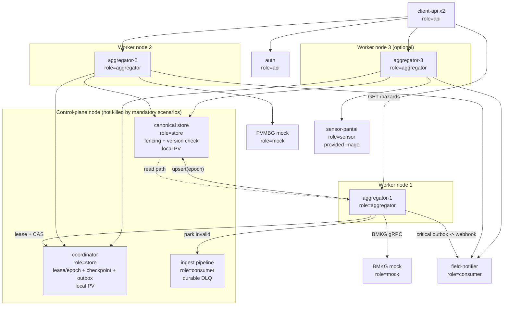

# Problem 2 — Two captains, one ship

## 1. Problem identification

Three Aggregator replicas must behave like one: every upstream poll is done once,
every HazardEvent is stored once, and a failure must not create two writers. This
is the classic **duplicate work / split-brain** problem. The relevant literature
and patterns are:

- **Leader election** and **leases** (Lamport; Kubernetes `Lease`; Chubby).
- **Fencing tokens** (Kleppmann, *How to do distributed locking*): a lock alone is
  not enough because a paused holder can wake up and write.
- **The GC-pause / process-pause problem**: a holder can stop for longer than its
  lease; wall clocks and even `CLOCK_MONOTONIC` can behave unexpectedly across VM
  suspend.
- **Clock skew** and the danger of comparing timestamps across machines.
- **Compare-and-set (CAS)** / optimistic concurrency for checkpoint commits.
- **Idempotent upserts** and deterministic keys for at-least-once retries.
- **Graceful degradation**: when coordination is unavailable, stop polling rather
  than risk two writers (safety over liveness).

## 2. Chosen mechanism

### 2.1 Per-source lease with a durable, monotonic epoch

A dedicated coordination store (`services/coordinator`, `role=store`) holds, for
each source (`BMKG`, `PVMBG`, `SENSOR_PANTAI`):

```
lease:      holder, epoch, monotonic deadline
epoch:      durable, incremented on every acquisition
checkpoint: cursor JSON + epoch + updated_at
outbox:     critical notification entries (P5 priority lane)
```

- `POST /v1/leases/{source}/acquire` increments and persists the epoch **before**
  responding.
- Lease expiry is measured with the coordinator's **in-process monotonic**
  deadline. Wall-clock `expires_at` is stored only for humans.
- On coordinator restart, all active leases are invalidated; durable epochs are
  kept, so the next acquisition gets a higher epoch.
- `PUT /v1/checkpoints/{source}` is a CAS on the current epoch.

### 2.2 Fencing at the resource

Every canonical write carries `fencing_epoch` and `fencing_scope` (source name).
The canonical store records `max(epoch)` per scope and rejects lower epochs with
`409 fenced`. This follows the M2 canonical contract (`contracts/m2/README.md`);
the shipped canonical store implements it. Without this check, a frozen holder could
still write after a takeover. The Aggregator also self-fences (stops work when
renewal fails), but the resource check is the safety net.

### 2.3 Poll loop

```
acquire -> read checkpoint -> fetch upstream -> idempotent upsert(epoch)
        -> CAS checkpoint(epoch) -> repeat
```

- Deterministic `source_ref_id` for every source. Sensor ids use the composite
  `station_id + observed_at + observation_id`.
- Upsert is last-version-wins; overlapping re-fetch after handover is harmless.
- Checkpoint advances only after all writes in the batch succeed.
- On graceful shutdown the leader releases the lease voluntarily.
- On crash, takeover happens after the TTL (~15 s), well under 60 s.

### 2.4 Timeouts and trade-offs

| Parameter | Value | Rationale |
|---|---|---|
| `LEASE_TTL` | 15 s | Worst-case crash takeover ≈15 s (<60 s); not so short that GC/network pauses cause frequent false failovers |
| `LEASE_RENEW_INTERVAL` | 5 s | Three renewals per TTL; survives one lost renew |
| `LEASE_SAFETY_MARGIN` | 2 s | Stop before the deadline if renewal reports <2 s remaining |
| Coordinator call timeout | 5 s | A hung coordinator must not hang the poller |
| Storage call timeout | 5 s | Bounded write path |
| `POLL_INTERVAL` | 3 s | M1 default, preserved |
| Shutdown drain | 5 s preStop + 5 s in-process + 30 s grace | Let the Service endpoint update, drain in-flight, release lease |

Shorter TTL = faster failover but more false failovers under pauses; 15 s is the
documented choice. The coordinator is a single writer; its SQLite transaction and
durable counter are the source of truth, not any node's clock.

## 3. Why the safety argument holds

1. **Clock shift (+45 s / −30 s)**: expiry is a monotonic deadline in the
   coordinator; acquisition increments a durable counter. A shifted client clock
   changes only display timestamps. Two clients cannot receive the same epoch.
2. **Suspend/freeze beyond TTL**: the coordinator's monotonic deadline passes;
   another holder acquires a higher epoch. The frozen holder may believe it is
   valid, but:
   - its checkpoint CAS uses the old epoch → `409`;
   - its storage upsert carries the old epoch → `409 fenced` at the resource.
   Nothing is persisted.
3. **Split brain attempt**: the SQLite-backed acquire is serialized; the epoch is
   persisted before the response. The storage max-epoch check rejects any older
   writer even if it bypasses the coordinator.
4. **Coordinator unreachable**: instances keep serving reads from storage, stop
   polling, and retry acquisition. No new leader can be minted without the store.

The unit tests in `services/coordinator/lease_test.go` exercise exactly these
cases with an injectable wall+monotonic clock.

## 4. Alternatives considered

| Alternative | Why not chosen |
|---|---|
| etcd lease + txn | Extra quorum, TLS, and a second data plane; overkill for three sources; still needs checkpoints/outbox |
| PostgreSQL advisory locks | Server + storage + credentials; more moving parts for a single writer |
| One global lease | A stuck source would block all sources; per-source isolation is required by the bulkhead criterion |
| Holder-only self-fencing | A suspended holder can wrongly believe it is valid; resource-level fencing is required |
| Kafka partition ownership | C's broker may not exist; P2 must be independent; also doesn't cover storage fencing |
| Rely on wall-clock expiry | Violates the clock-shift criterion; cross-machine timestamps are unsafe |

## 5. Conscious limitations

- The coordinator and the canonical store are **single replicas pinned to the
  control-plane node**. Mandatory Tester scenarios kill workers only, so this is
  acceptable for the demo; a control-plane failure stops polling (reads still
  serve last known data). Replication/HA is future work.
- The ledger of exactly-once is per source, not a distributed transaction across
  sources. The assignment requires per-source exactly-once.
- The local SQLite mirror in Compose is a demo convenience; Kubernetes uses the
  shared storage contract.
- The `quality` enum and severity thresholds for the sensor are assumptions until
  the black box is observed (see `docs/B-plan.md`).

## 6. Architecture and data path



Only one instance per source holds the current epoch; the Service is the single
entry point for reads/audit. Fencing is checked at `STORE`.

## 7. Evidence per criterion

Run on the demo cluster. Replace placeholders with screenshots/outputs.

### Criterion 1 — 3 instances, one entry point, probes, spreading, PDB

```bash
kubectl -n sistem-informasi-kebencanaan-bnpb get deploy aggregator -o yaml \
  | grep -E 'replicas|maxUnavailable|maxSurge|topologySpread|readinessProbe|preStop'
kubectl -n sistem-informasi-kebencanaan-bnpb get pods -l app=aggregator -o wide
kubectl -n sistem-informasi-kebencanaan-bnpb get endpoints aggregator
kubectl -n sistem-informasi-kebencanaan-bnpb get pdb aggregator
```

Expected: 3 ready pods on ≥2 nodes; endpoints list 3 addresses; PDB
`minAvailable: 2`; readiness `/readyz` fails when storage is unreachable.
Screenshot: `kubectl get pods -o wide` + `kubectl describe deploy aggregator`.

### Criterion 2 — exactly-once

```bash
./loadtest/duplicate-detector.sh
curl -s http://<bmkg-admin>/admin/requests | jq '[.[] | {caller_instance, method}] | group_by(.) | map({k:.[0], n:length})'
curl -s http://<pvmbg>/admin/requests | jq ...
```

Expected: `storage rows=N duplicate_keys=0`; no 1-second bucket with two caller
instances; storage `/events` has one row per `source_ref_id`.
Screenshot: detector output and mock `caller_instance` logs.

### Criterion 3 — leader death, ≤60 s, no gap/duplicate

```bash
# find the current leader in the metrics
curl -s http://aggregator:8085/metrics | grep 'lease_holder'
kubectl -n ... delete pod <leader>
# watch epoch and checkpoint
kubectl -n ... logs -f deploy/aggregator | grep -E 'lease_acquired|lease_renew_failed|poll_committed'
./loadtest/duplicate-detector.sh
```

Expected: a new epoch is acquired within ~15 s; the new leader resumes from the
checkpoint; detector still passes. Screenshot: lease epoch graph + logs.

### Criterion 4 — node clock shift

Use the Tester Agent clock-shift practice on the node hosting the leader, e.g.
`+45s` then `−30s` (exact command from `tester-agent /app list`).

Expected: no duplicate successful persists for the same poll period;
`fenced_writes_total` may increase (that is the safety net doing its job); no
change in storage row count beyond the legitimate events. Screenshot: fenced
writes panel + storage row count.

### Criterion 5 — frozen holder wakes up

```bash
kubectl -n ... exec <leader> -- kill -STOP 1
# or use the Tester Agent suspend/freeze practice
./loadtest/duplicate-detector.sh
kubectl -n ... exec <leader> -- kill -CONT 1
```

Expected: takeover after TTL; when the old process resumes it logs
`lease_renew_failed_self_fencing` and/or 409 from storage; it persists nothing
until it re-acquires. Screenshot: aggregator log of 409/fenced + unchanged
checkpoint epoch from the old holder.

Automation: `./scripts/integration-pause-leader.sh` performs SIGSTOP/SIGCONT and
then kills the leader, running the duplicate detector before and after.

### Criterion 6 — 10k VUs / 120 s, scale 3→5→2

```bash
./loadtest/scaling.sh
```

Expected: `unexpected_errors` gives <1 % (`controlled_rejections` excluded);
detector passes afterwards. Attach `loadtest/results/scaling-summary.json`,
`scaling-pods.txt`, and the detector output.

### Criterion 7 — 3 vs 1 throughput ≥ 2.0×

```bash
./loadtest/throughput.sh
```

Expected output:

```
1 instance : X req/s
3 instances: Y req/s
ratio      : Y/X (target >= 2.0)
```

### Criterion 8 — rolling update, zero failed requests

```bash
./loadtest/rolling-update.sh
```

Expected: `unexpected_errors=0`, rollout completes while the load runs; pods
never drop below 2 ready (PDB + maxUnavailable 0).

## 8. Test configuration

| Test | Executor | Load | Duration |
|---|---|---|---|
| Sustained/scaling | `constant-vus` | 10,000 VUs | 120 s |
| Throughput | `constant-vus`, `SLEEP=0` | 200 VUs | 60 s each |
| Rolling update | `constant-vus` | 2,000 VUs | 90 s |
| Priority (P5) | two `constant-vus` scenarios | 4,000 field + 4,000 media | 90 s |

Tools: k6 v1.x, `kubectl`, `python3`. Raw outputs in `loadtest/results/`.

## 9. Session verification (no cluster)

A local smoke test ran the real Aggregator binary with coordinator, canonical store,
ingest-pipeline DLQ, field-notifier, BMKG/PVMBG mocks and a contract-conforming fake sensor:
`BMKG=20`, `PVMBG=20`, `SENSOR_PANTAI=8` rows, `duplicates=0`, 7 critical alerts
received, audit proxy working, one epoch per source. Unit tests cover the
fake-clock lease, split brain, frozen holder, checkpoint CAS, stale-epoch
fencing, sensor validation/breaker/progress. Cluster-scale evidence (10k VUs,
node kill, clock shift) must be captured on the demo cluster with the commands
above.
